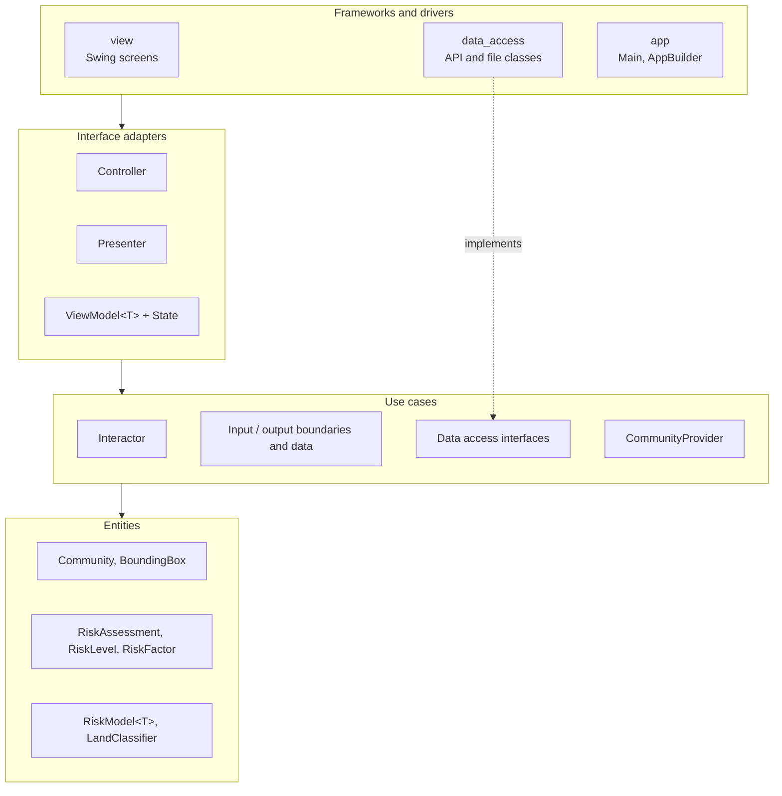
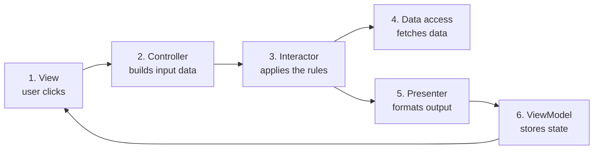

# NorthWatch architecture outline

A working outline for the team. **Every class below already exists as a stub** that compiles
and is wired into `AppBuilder`; the app runs and each tab shows "not implemented yet".
Search the code for `TODO Member A` (B, C, D) to find your work, and tick a box when that
class is fully implemented and tested.

## 1. The layers

**The one rule:** code only depends on layers below it. `data_access` classes implement
interfaces declared in `use_case`, so interactors never know which API or file they use.
`AppBuilder` is the only class allowed to know every concrete class.

| Layer | Package | Allowed to import |
|---|---|---|
| Entities | `entity`, `entity.risk` | Java standard library only |
| Use cases | `use_case.<story>`, `use_case.shared` | `entity` |
| Interface adapters | `interface_adapter`, `interface_adapter.<story>` | `use_case`, `entity` |
| Frameworks and drivers | `view`, `data_access`, `app` | anything inward; Swing, OkHttp, org.json, ImageIO live here only |

## 2. How one click flows through a story

Every interactor follows the same pattern: look up the community with `CommunityProvider`,
call its data access interfaces (catching `DataUnavailableException`), apply the entity rules,
then call `prepareSuccessView` or `prepareFailView` on its presenter.

## 3. Shared contract (done; change only by a team-reviewed PR)

- [x] `entity.Community`, `entity.BoundingBox`, `entity.Hazard`
- [x] `entity.RiskLevel`, `entity.RiskFactor`, `entity.RiskAssessment`
- [x] `entity.risk.RiskModel<T>` (Strategy)
- [x] `use_case.shared.CommunityProvider`, `use_case.shared.DataUnavailableException`
- [x] `data_access.DemoCommunityProvider`, `data_access.ApiConfig`
- [x] `interface_adapter.ViewModel<T>` (Observer)
- [x] `app.Main`, `app.AppBuilder` (one method pair per story, all wired)
- [x] Entity tests, `pom.xml`, Checkstyle, CI, PR template

## 4. Work order for every member

1. Entities for your story
2. Interactor + interactor tests with fake data access objects (no API, no GUI needed)
3. Presenter formatting
4. Real data access classes + a parsing test on a saved sample response
5. Swing view polish (charts, pictures, SwingWorker)

Steps 1–3 depend only on the shared contract, so all four members can start the same day.

## 5. Member outlines

### Member A — Story 1: Watchlist

| Layer | Class | Notes |
|---|---|---|
| Entity | [ ] `entity.Watchlist` | `add` (no duplicates), `remove`, `rename`, `find` |
| Use case | [x] `SaveCommunityInputBoundary`, `SaveCommunityInputData`, `SaveCommunityOutputBoundary`, `SaveCommunityOutputData` | load, search, save, remove, rename |
| | [ ] `SaveCommunityInteractor` | |
| | [x] `PlaceSearchDataAccessInterface`, `WatchlistDataAccessInterface` | Interface Segregation |
| Adapter | [x] `SaveCommunityController`, `SaveCommunityState` · [ ] `SaveCommunityPresenter` (labels) | |
| Data access | [ ] `GeocodingDataAccessObject` | place search, Canada only |
| | [ ] `FileWatchlistDataAccessObject` | `~/.northwatch/watchlist.json` |
| | [ ] `CloudWatchlistDataAccessObject` | course user-data API |
| | [ ] `FallbackWatchlistDataAccessObject` | Decorator: cloud first, file when offline |
| | [x] `WatchlistCommunityProvider` | lets stories 2–4 read the watchlist |
| View | [ ] `view.WatchlistView` | rename, "name, province" display, SwingWorker |
| Tests | [ ] `SaveCommunityInteractorTest`, `WatchlistTest` | |
| Integration | [ ] switch `AppBuilder.communityProvider` to `WatchlistCommunityProvider`; real sign-in | |

Design to present: Dependency Inversion (file vs cloud store), Decorator (offline fallback), Interface Segregation.

### Member B — Story 2: Flood risk

| Layer | Class | Notes |
|---|---|---|
| Entity | [ ] `FlowForecast`, `FlowHistory`, `WeatherOutlook` | `peak`, `percentileOf`, `median`, `maxRainOver`, `warmDays` |
| | [x] `RiverGauge`, `GaugeReading` | |
| | [x] `entity.risk.FloodConditions` · [ ] `entity.risk.FloodRiskModel` | the flood rules |
| Use case | [x] `FloodRiskInputBoundary`, `FloodRiskInputData`, `FloodRiskOutputBoundary`, `FloodRiskOutputData` | |
| | [ ] `FloodRiskInteractor` | 7 daily ratings; "Cannot assess" if data missing |
| | [x] `RiverDataAccessInterface`, `FloodWeatherDataAccessInterface` | |
| Adapter | [x] `FloodRiskController`, `FloodRiskState` · [ ] `FloodRiskPresenter` | |
| Data access | [ ] `HydrologyDataAccessObject` | flow forecast + history (cached), gauges |
| | [ ] `FloodWeatherDataAccessObject` | forecast and historical weather |
| View | [ ] `view.FloodRiskView` | date picker, JFreeChart, SwingWorker |
| Tests | [ ] `FloodRiskModelTest`, `FloodRiskInteractorTest` | one test per rule |

Design to present: Strategy + Open/Closed (`RiskModel`).

### Member C — Story 3: Nearby wildfires

| Layer | Class | Notes |
|---|---|---|
| Entity | [x] `entity.FireDetection`, `entity.risk.FireConditions` | |
| | [ ] `entity.risk.WildfireRiskModel` | distance, wind toward town, count, intensity |
| Use case | [x] `NearbyFiresInputBoundary`, `NearbyFiresInputData`, `NearbyFiresOutputBoundary`, `NearbyFiresOutputData` | |
| | [ ] `NearbyFiresInteractor` | |
| | [x] `FireDataAccessInterface`, `WindDataAccessInterface` | |
| Adapter | [x] `NearbyFiresController`, `NearbyFiresState` · [ ] `NearbyFiresPresenter` | |
| Data access | [ ] `FirmsDataAccessObject`, `FirmsCsvParser` | key from `config.properties` |
| | [ ] `WindDataAccessObject` | own class; not shared with B |
| View | [ ] `view.FireMapView`, `view.MapPanel` | map picture, fire markers, wind arrow |
| Tests | [ ] `WildfireRiskModelTest`, `NearbyFiresInteractorTest`, `FirmsCsvParserTest` | |

Design to present: Single Responsibility (fetch / parse / score / present / draw are separate).

### Member D — Story 4: Compare satellite pictures

| Layer | Class | Notes |
|---|---|---|
| Entity | [x] `entity.ImageType` · [ ] `entity.SatelliteImage` | `affectedFraction`, `unusableFraction` |
| | [x] `entity.risk.LandClassifier` · [ ] `WaterClassifier`, `BurnScarClassifier` | Strategy |
| Use case | [x] `CompareImageryInputBoundary`, `CompareImageryInputData`, `CompareImageryOutputBoundary`, `CompareImageryOutputData`, `CompareImageryDataAccessInterface` | |
| | [ ] `CompareImageryInteractor` | |
| Adapter | [x] `CompareImageryController`, `CompareImageryState` · [ ] `CompareImageryPresenter` | |
| Data access | [ ] `GibsImageryDataAccessObject` | PNG only; ImageIO stays here |
| | [ ] `CachingImageryDataAccessObject` | Decorator: `~/.northwatch/cache/images/` |
| View | [ ] `view.ImageCompareView` | show pixel arrays as pictures; date validation |
| Tests | [ ] classifier tests, `CompareImageryInteractorTest`, imagery contract test | Liskov |

Design to present: Decorator (cache), Strategy (water vs burn classifier), Liskov (contract test).

## 6. Integration (last week)

- [ ] Switch `AppBuilder.communityProvider` to Member A's watchlist and refresh drop-downs when it changes
- [ ] Optional: merge B's and C's weather classes into one (a planned refactor to show)
- [ ] Optional: let D reuse C's `MapPanel` to mark the community on pictures
- [ ] Delete `view.PlaceholderView` (no longer used)
- [ ] PlantUML sequence diagram per story in `plantuml/`
- [ ] Checkstyle warnings to zero, then set `failOnViolation` to true
